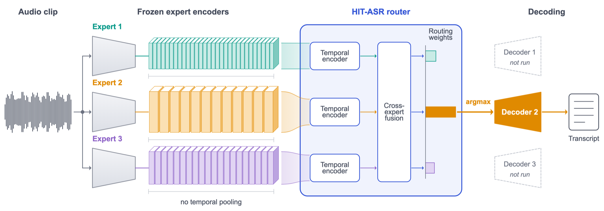

<div align="center">

<h1>HIT-ASR: Hierarchical Transformer Routing for Adaptive ASR Expert Selection</h1>

**Under review · IEEE Transactions on Audio, Speech and Language Processing**

[Huseyin Karaca](https://hkaraca.com/), A. Samil Namli, Suleyman S. Kozat<br>
Bilkent University

[Paper](https://hkaraca.com/assets/pdf/hit-asr.pdf) ·
[Project page](https://hkaraca.com/hit-asr/) ·
[Data](https://huggingface.co/datasets/huseyin-karaca/hit-asr)

</div>

HIT-ASR is a router that picks, for each audio clip, one ASR system from a pool of frozen experts before any of them
decodes. It reads every expert's frame-level encoder states with a hierarchical transformer and attains the lowest
WER on all four corpora, 6.3–11.2 % relative below the best single expert. This repository holds the code, the
notebooks behind every table, and the data on the Hugging Face Hub.

<p align="center"></p>
<p align="center"><em>The router reads every expert's encoder states, unpooled; only the chosen decoder runs.</em></p>

## Installation

Python ≥ 3.10. A CPU is enough for level 1; levels 2 and 3 use one GPU.

```bash
pip install "hit-asr[paper] @ git+https://github.com/huseyin-karaca/hit-asr"
```

Docker images: `ghcr.io/huseyin-karaca/hit-asr:cpu` and `ghcr.io/huseyin-karaca/hit-asr:cuda`.

## Quick start

Recompute the AMI-SDM tables from the records on the Hub (a CPU, a few minutes):

```bash
python -m hitasr.experiment ami_sdm --device cpu    # prints the paper's tables for AMI-SDM
```

Other corpora: `earnings22`, `peoples_speech`, `afrispeech`. Add `--level 2` to retrain every model on a GPU.

## Reproducing the paper

One notebook per experiment. Set `LEVEL` in its first cell:
**1** every table from the stored runs (CPU, minutes), **2** every model retrained (GPU, 35–80 min per corpus on a
Colab G4), **3** level 2 on features rebuilt from the audio with [`extract`](notebooks/extract.ipynb).

| Notebook | Reproduces | HIT-ASR WER | |
|---|---|--:|---|
| [`main_ami_sdm`](notebooks/main_ami_sdm.ipynb) | Tables 1, 2, 3, 6 on AMI-SDM | 17.19 | [](https://colab.research.google.com/github/huseyin-karaca/hit-asr/blob/main/notebooks/main_ami_sdm.ipynb) |
| [`main_earnings22`](notebooks/main_earnings22.ipynb) | the same on Earnings-22 | 11.98 | [](https://colab.research.google.com/github/huseyin-karaca/hit-asr/blob/main/notebooks/main_earnings22.ipynb) |
| [`main_peoples_speech`](notebooks/main_peoples_speech.ipynb) | the same on People's Speech | 15.80 | [](https://colab.research.google.com/github/huseyin-karaca/hit-asr/blob/main/notebooks/main_peoples_speech.ipynb) |
| [`main_afrispeech`](notebooks/main_afrispeech.ipynb) | the same on AfriSpeech-200 | 22.93 | [](https://colab.research.google.com/github/huseyin-karaca/hit-asr/blob/main/notebooks/main_afrispeech.ipynb) |
| [`ablation`](notebooks/ablation.ipynb) | design switches, number of experts | | [](https://colab.research.google.com/github/huseyin-karaca/hit-asr/blob/main/notebooks/ablation.ipynb) |
| [`timing`](notebooks/timing.ipynb) | cost on raw audio | | [](https://colab.research.google.com/github/huseyin-karaca/hit-asr/blob/main/notebooks/timing.ipynb) |
| [`synthetic`](notebooks/synthetic.ipynb) | synthetic regime-switch check | | [](https://colab.research.google.com/github/huseyin-karaca/hit-asr/blob/main/notebooks/synthetic.ipynb) |
| [`manuscript_tables`](notebooks/manuscript_tables.ipynb) | every LaTeX table, into [`tables/`](tables) | | [](https://colab.research.google.com/github/huseyin-karaca/hit-asr/blob/main/notebooks/manuscript_tables.ipynb) |

WER is test WER (%), the mean over the ten folds of a 5×2 cross-validation. Level 1 reproduces every table exactly;
the [reproducibility report](notes/reproducibility.md) has the test runs, hardware and cost.

## Data

The Hugging Face dataset [`huseyin-karaca/hit-asr`](https://huggingface.co/datasets/huseyin-karaca/hit-asr) holds the
16 kHz audio, every expert's transcripts and frame-level encoder states, and the stored runs. The notebooks download
what they need. Each corpus keeps its own licence; see [`notes/data.md`](notes/data.md).

## Citation

```bibtex
@article{karaca2026hitasr,
  title  = {{HIT-ASR}: Hierarchical Transformer Routing for
            Adaptive {ASR} Expert Selection},
  author = {Karaca, Huseyin and Namli, A. Samil and Kozat, Suleyman S.},
  year   = {2026},
  note   = {Under review},
  url    = {https://hkaraca.com/hit-asr/}
}
```

## License

Code: [Apache-2.0](LICENSE). The data on the Hub keeps the licence of the corpus it comes from.
